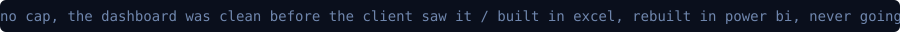

<h1 align="center">Hey, I'm Amr 👋</h1>
<h3 align="center">Data Engineering Trainee • CIE Student @ Zewail City • Dashboard Enjoyer</h3>

  

---

### 🧠 About Me
- 🎓 Communications & Information Engineering @ **Zewail City** (class of 2027)
- 📊 Power BI specialist (DEPI) → now leveling up in **Data Engineering**
- ☢️ Spent time at the **Egyptian Atomic Energy Authority** doing radiation measurement, LabVIEW and IoT (yes, really)
- 🌍 Climate Awareness Ambassador, because data should also save the planet
- 📍 Giza, Egypt

### 🧰 Tools I Use

  
  
  
  
  

### 📈 Things I Built
| Project | What it does |
|---|---|
| 🏭 **Production Performance Dashboard** | Tracks batch times and finds bottlenecks (Completed vs Cancelled vs Incomplete) |
| 💰 **Sales Analytics Dashboard** | Sales, orders and customers with slicers for Year, Country and Territory |

### 🤡 Fun Facts
- I've calibrated a radiation instrument, but I can't calibrate my sleep schedule
- My dashboards load faster than my morning motivation
- I say "it's just a data cleaning issue" about everything, including life
- I name files `final`, `final2`, and `final_REAL_final`

### 📊 Stats

  

### 🔗 Let's Connect

<i>I reply faster to memes than to emails 🐸</i>

