I'm a Communications & Information Engineering student at Zewail City, and I spend most of my time turning messy data into things people can actually read. Right now I'm in the DEPI Data Engineering track, learning how data gets from "somewhere" to "ready to use."

Before that I did a Power BI internship, and this summer I spent two weeks at the Egyptian Atomic Energy Authority measuring radiation and calibrating an instrument with LabVIEW. Different field, same obsession: if the numbers are wrong, nothing after them matters.

## Work

**[Production Performance Dashboard](https://www.linkedin.com/posts/amr-hatem-3b55082a2_powerbi-dataanalytics-datavisualization-activity-7401323541675188225-ejdI)**
Power BI. Tracks batch times and statuses to show where a production line loses time.

**[Sales Analytics Dashboard](https://www.linkedin.com/posts/amr-hatem-3b55082a2_powerbi-dataanalytics-datavisualization-activity-7376798682588934144-FbbD)**
Power BI. Sales, orders and customers with slicers, so non-technical people can explore it themselves.

## Now

- Data engineering with DEPI
- Studying CIE, class of 2027
- Climate Awareness Ambassador with the EAEA

## Toolbox

Power BI · Excel · Data modeling · LabVIEW · IoT & embedded systems

## Contact

[LinkedIn](https://www.linkedin.com/in/amr-hatem-3b55082a2/)
